<picture>
  <source media="(prefers-color-scheme: dark)" srcset="https://raw.githubusercontent.com/saswatsam786/saswatsam786/main/assets/hero-dark.svg">
  
</picture>

  <a href="https://www.linkedin.com/in/saswatsam/">
    <picture>
      <source media="(prefers-color-scheme: dark)" srcset="https://raw.githubusercontent.com/saswatsam786/saswatsam786/main/assets/pill-linkedin-dark.svg">
      
    </picture>
  </a>
  <a href="mailto:saswat.sam786@gmail.com">
    <picture>
      <source media="(prefers-color-scheme: dark)" srcset="https://raw.githubusercontent.com/saswatsam786/saswatsam786/main/assets/pill-email-dark.svg">
      
    </picture>
  </a>
  <a href="https://saswatblogs.hashnode.dev/">
    <picture>
      <source media="(prefers-color-scheme: dark)" srcset="https://raw.githubusercontent.com/saswatsam786/saswatsam786/main/assets/pill-blog-dark.svg">
      
    </picture>
  </a>
  <a href="https://x.com/SaswatTwts">
    <picture>
      <source media="(prefers-color-scheme: dark)" srcset="https://raw.githubusercontent.com/saswatsam786/saswatsam786/main/assets/pill-x-dark.svg">
      
    </picture>
  </a>
  <a href="https://drive.google.com/file/d/1hcg60KqwyXEZT8eU0x7rrYEkEJ4cdWEz/view">
    <picture>
      <source media="(prefers-color-scheme: dark)" srcset="https://raw.githubusercontent.com/saswatsam786/saswatsam786/main/assets/pill-resume-dark.svg">
      
    </picture>
  </a>

<picture>
  <source media="(prefers-color-scheme: dark)" srcset="https://raw.githubusercontent.com/saswatsam786/saswatsam786/main/assets/section-01-dark.svg">
  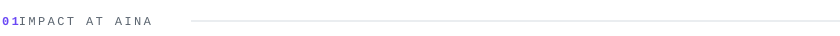
</picture>

At [Aina](https://aina.co) ($5.5M seed) we build hardware for AI agents. **Dune**, a context-aware 3-key Mac keypad, hit #1 on Product Hunt. **Aina Ring**, a ring with a small screen that shows the one decision your agents need from you, launched in San Francisco and Bangalore in November 2026. I built the ring's voice agent and moved our backend to production AWS.

<picture>
  <source media="(prefers-color-scheme: dark)" srcset="https://raw.githubusercontent.com/saswatsam786/saswatsam786/main/assets/metrics-dark.svg">
  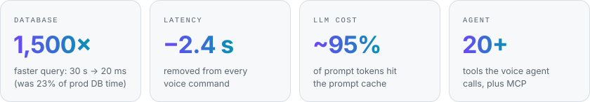
</picture>

<b>What I built at Aina</b>

 

- Built the **AI voice agent for Aina Ring**: LLM tool calling (Claude, OpenAI) over 20+ tools, plus MCP connectors (Notion, Slack, Linear) for home control, Spotify, calendars and notes
- Gave it **long-term memory with RAG**: local embeddings and pgvector (HNSW) search, with prompt caching on ~95% of prompt tokens
- **Migrated the whole backend to production AWS**: RDS Postgres, 9 ECS services, CodeBuild + ECR CI/CD, EventBridge, SQS/SNS and a private VPC
- Rebuilt the **analytics pipeline**: API Gateway → Kinesis → Firehose → S3 (Parquet) → Glue → Athena, with DMS change data capture from Postgres
- Fixed a **WhatsApp outage** that hit at 6 users (thread-pool exhaustion); it now handles 100+ sessions
- Shipped a **Home Assistant plugin** with signed self-updates and auto-rollback, so voice can control any device

<picture>
  <source media="(prefers-color-scheme: dark)" srcset="https://raw.githubusercontent.com/saswatsam786/saswatsam786/main/assets/section-02-dark.svg">
  
</picture>

<picture>
  <source media="(prefers-color-scheme: dark)" srcset="https://raw.githubusercontent.com/saswatsam786/saswatsam786/main/assets/journey-dark.svg">
  
</picture>

<b>Earlier roles</b>

 

**Badho** · Full-Stack Developer · *Oct 2024 – Nov 2025*
- Designed a **workflow orchestration engine** on Temporal (Node.js, PostgreSQL) with a JSON DSL, auto-versioning and multiple queues, built for millions of workflows. Deployments went from days to minutes
- Built **ONDC seller microservices** (search, select, confirm, cancel, fulfillment) with UPI/NEFT settlements
- Ran the services on Docker and Azure with CI/CD, and **Prometheus, Grafana and Loki** for monitoring, alerts and logs

**UniStack** · SDE Intern · *Nov 2023 – Sep 2024*
- Built the backend (Node.js, TypeScript) and the Next.js client for UniStack's payment system
- Built search, confirmation, status, tracking and cancellation for the **ONDC logistics buyer app**, cutting task completion times by 20%

<picture>
  <source media="(prefers-color-scheme: dark)" srcset="https://raw.githubusercontent.com/saswatsam786/saswatsam786/main/assets/section-03-dark.svg">
  
</picture>

<a href="https://github.com/lima-vm/lima/pull/5675">
  <picture>
    <source media="(prefers-color-scheme: dark)" srcset="https://raw.githubusercontent.com/saswatsam786/saswatsam786/main/assets/oss-lima-5675-dark.svg">
    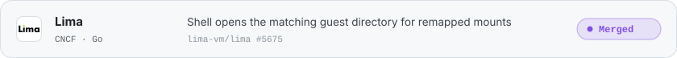
  </picture>
</a>
<a href="https://github.com/lima-vm/lima/pull/5602">
  <picture>
    <source media="(prefers-color-scheme: dark)" srcset="https://raw.githubusercontent.com/saswatsam786/saswatsam786/main/assets/oss-lima-5602-dark.svg">
    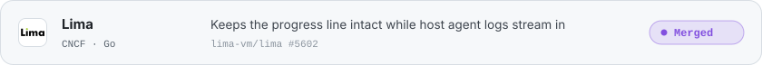
  </picture>
</a>
<a href="https://github.com/lima-vm/lima/pull/5771">
  <picture>
    <source media="(prefers-color-scheme: dark)" srcset="https://raw.githubusercontent.com/saswatsam786/saswatsam786/main/assets/oss-lima-5771-dark.svg">
    
  </picture>
</a>
<a href="https://github.com/jaegertracing/jaeger/pull/9930">
  <picture>
    <source media="(prefers-color-scheme: dark)" srcset="https://raw.githubusercontent.com/saswatsam786/saswatsam786/main/assets/oss-jaeger-9930-dark.svg">
    
  </picture>
</a>
<a href="https://github.com/ai-dynamo/dynamo/pull/16127">
  <picture>
    <source media="(prefers-color-scheme: dark)" srcset="https://raw.githubusercontent.com/saswatsam786/saswatsam786/main/assets/oss-dynamo-16127-dark.svg">
    
  </picture>
</a>
<a href="https://github.com/topoteretes/cognee/pull/5674">
  <picture>
    <source media="(prefers-color-scheme: dark)" srcset="https://raw.githubusercontent.com/saswatsam786/saswatsam786/main/assets/oss-cognee-5674-dark.svg">
    
  </picture>
</a>

<a href="https://github.com/search?q=author%3Asaswatsam786+is%3Apr+-user%3Asaswatsam786&type=pullrequests">All my pull requests →</a>

<picture>
  <source media="(prefers-color-scheme: dark)" srcset="https://raw.githubusercontent.com/saswatsam786/saswatsam786/main/assets/section-04-dark.svg">
  
</picture>

  <a href="https://github.com/saswatsam786/snapshell">
    <picture>
      <source media="(prefers-color-scheme: dark)" srcset="https://raw.githubusercontent.com/saswatsam786/saswatsam786/main/assets/card-snapshell-dark.svg">
      
    </picture>
  </a>
  <a href="https://x.com/SaswatTwts/status/2084023729777221884">
    <picture>
      <source media="(prefers-color-scheme: dark)" srcset="https://raw.githubusercontent.com/saswatsam786/saswatsam786/main/assets/card-circle-dark.svg">
      
    </picture>
  </a>

  <a href="https://x.com/SaswatTwts/status/2077896242500391400">
    <picture>
      <source media="(prefers-color-scheme: dark)" srcset="https://raw.githubusercontent.com/saswatsam786/saswatsam786/main/assets/card-diary-dark.svg">
      
    </picture>
  </a>
  <a href="https://github.com/saswatsam786/telepilot">
    <picture>
      <source media="(prefers-color-scheme: dark)" srcset="https://raw.githubusercontent.com/saswatsam786/saswatsam786/main/assets/card-telepilot-dark.svg">
      
    </picture>
  </a>

  <a href="https://github.com/saswatsam786/vessl">
    <picture>
      <source media="(prefers-color-scheme: dark)" srcset="https://raw.githubusercontent.com/saswatsam786/saswatsam786/main/assets/card-vessl-dark.svg">
      
    </picture>
  </a>
  <a href="https://x.com/SaswatTwts/status/2040093157006909580">
    <picture>
      <source media="(prefers-color-scheme: dark)" srcset="https://raw.githubusercontent.com/saswatsam786/saswatsam786/main/assets/card-button-dark.svg">
      
    </picture>
  </a>

More: <a href="https://github.com/saswatsam786/redis">redis</a>, a Redis-compatible server in Go

<picture>
  <source media="(prefers-color-scheme: dark)" srcset="https://raw.githubusercontent.com/saswatsam786/saswatsam786/main/assets/section-05-dark.svg">
  
</picture>

<picture>
  <source media="(prefers-color-scheme: dark)" srcset="https://raw.githubusercontent.com/saswatsam786/saswatsam786/main/assets/toolkit-dark.svg">
  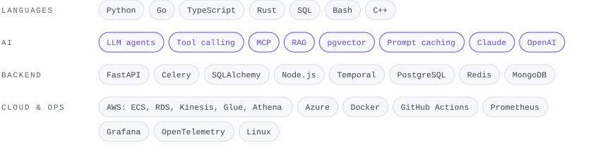
</picture>

<picture>
  <source media="(prefers-color-scheme: dark)" srcset="https://raw.githubusercontent.com/saswatsam786/saswatsam786/main/assets/section-06-dark.svg">
  
</picture>

<picture>
  <source media="(prefers-color-scheme: dark)" srcset="https://raw.githubusercontent.com/saswatsam786/saswatsam786/main/assets/recognition-dark.svg">
  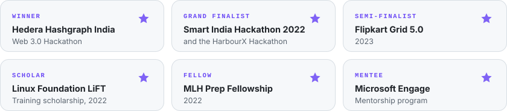
</picture>

<picture>
  <source media="(prefers-color-scheme: dark)" srcset="https://raw.githubusercontent.com/saswatsam786/saswatsam786/main/assets/section-07-dark.svg">
  
</picture>

<picture>
  <source media="(prefers-color-scheme: dark)" srcset="https://raw.githubusercontent.com/saswatsam786/saswatsam786/output/github-snake-dark.svg">
  
</picture>

This profile redraws itself every day from live GitHub data, with <a href="scripts/render.py">one Python script</a>.

